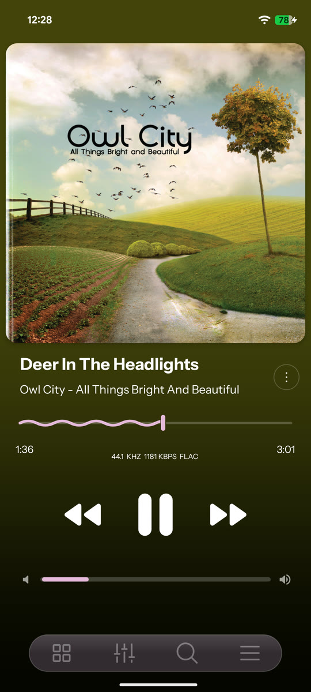
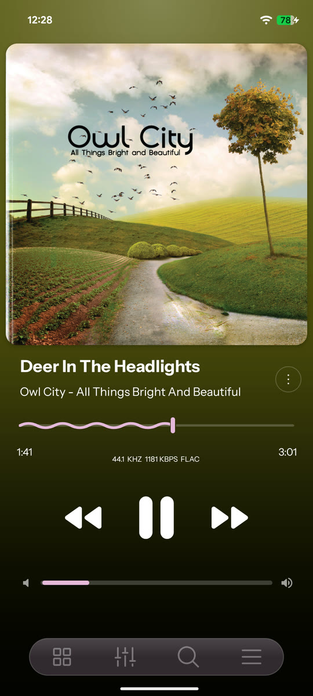
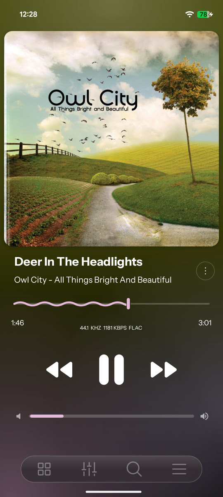
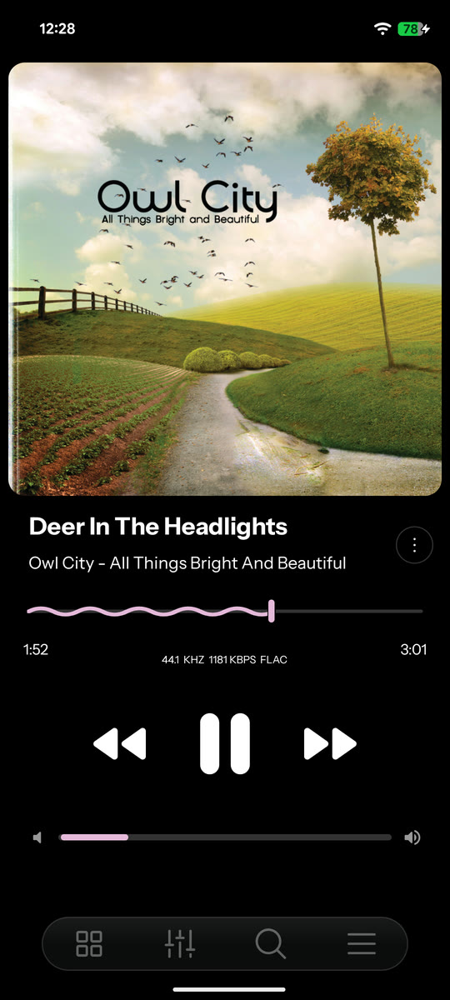
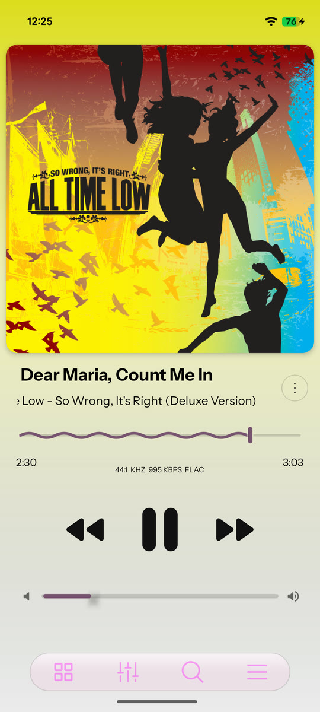
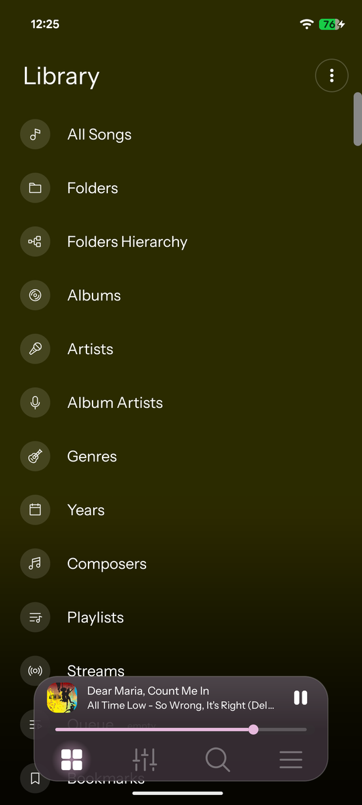
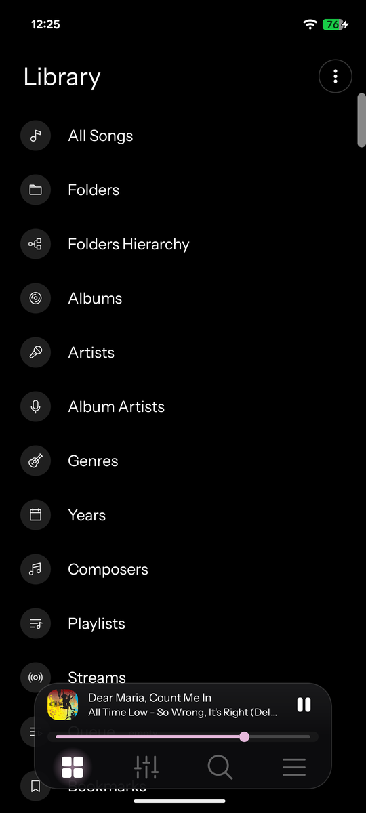
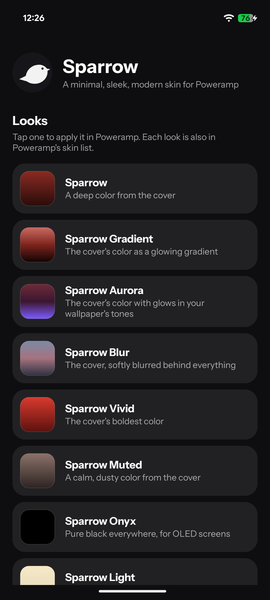

# Sparrow

A minimal, sleek, modern skin for [Poweramp](https://powerampapp.com/), the Android music player.

Sparrow keeps the screen calm: large rounded cover art, clean typography, quiet controls and lots of breathing room. It follows your system's light or dark mode.

## Screenshots

| Sparrow | Gradient | Aurora | Onyx |
|:---:|:---:|:---:|:---:|
|  |  |  |  |

| Light | Library | Library (Onyx) | The Sparrow app |
|:---:|:---:|:---:|:---:|
|  |  |  |  |

## Looks

Each look is a complete variant of Sparrow, listed as its own skin in Poweramp's skin list and in the Sparrow app's
gallery. Looks work right away, even before the skin is verified.

| Look | Style |
|---|---|
| Sparrow | A deep color from the cover |
| Sparrow Pop | The cover's color at full strength with soft bubbles, a big round cover, chunky Pill bars, Plus Jakarta Sans and play/pause in a white circle |
| Sparrow Paper | Cream paper, a sharp square cover, a big Instrument Serif title, thin lines, ink-black controls and a red accent |
| Sparrow Gradient | The cover's color as a glowing gradient: light at the top, deep at the bottom |
| Sparrow Aurora | The cover's color with soft glows in your wallpaper's tones |
| Sparrow Blur | The cover, blurred (follows Poweramp's Background settings) |
| Sparrow Onyx | Pure black everywhere, for OLED screens |
| Sparrow Light | Bright: a soft cover color at the top fading to white |

Covers without strong colors (black-and-white art, for example) get a black background in the color looks.
Pop replaced the Vivid look and Paper the Muted look; anyone who had those selected gets the new look. Poweramp darkens
the bottom of the player (its Background Gradient setting); turn that off for Pop's color all the way down.

## Options

Sparrow's options are in Poweramp's skin settings, on one page per part of the player, with small previews for the
progress bar, volume and lyrics styles. They take effect once the skin is verified; until then Poweramp uses the
defaults, marked in bold. "Match the look" lets each look pick its own font, progress bar and volume style. Each look
keeps its own options, as Poweramp saves them per skin.

| Page | Option | Choices |
|---|---|---|
| Colors | Background | Blur, **Cover color** (a rich color from the cover), Vivid, Muted |
| | Accent color (Android 12+) | Off, **Wallpaper** |
| Cover and track info | Layout | **Clean** (cover on top, track info below), Full cover |
| | Track info alignment | **Left**, Centered |
| | Track info background | Shown, **Hidden** |
| | Buttons on cover (rating, lyrics, menu) | Shown, **Hidden** |
| | More button (Clean layout) | Hidden, **By the title** |
| | Quick buttons (visualizer, timer, repeat, shuffle) | Shown, **Hidden** |
| Progress bar | Seekbar | Wave, Static, **Plain** (the Plain-only options leave Wave and Static as Poweramp designed them) |
| | Style (Plain seekbar) | **Match the look** (Sparrow: Wave line), Wave line, Line, Pill, Expressive, Glow |
| | Position (Plain seekbar) | Bottom, **Under track info** |
| | Time backgrounds (Plain seekbar) | Shown, **Hidden** |
| Playback buttons | Size (Plain seekbar) | Normal, **Large** |
| | Backgrounds | Shown (circles behind the controls), **Hidden** |
| | Extra skip buttons | Shown, **Hidden** |
| Volume slider | Volume slider | Hidden, **Shown** |
| | Style | **Match the look** (Sparrow: Minimal), Minimal, Line, Pill, Expressive, Glow |
| Nav bar and icons | Nav bar | Solid, **Glass** (wallpaper-tinted floating pill on every screen, glow behind the current tab) |
| | Icons (nav bar, Library) | Poweramp, **Phosphor** |
| Fonts | Font | **Match the look** (Sparrow: Instrument Sans), Instrument Sans, Plus Jakarta Sans, Manrope, Inter, System |
| | Dot-matrix font | **Off**, Times and format, Plus artist line |
| Lyrics | Style | **Spotlight** (big bold lines on the left), Centered zoom, Accent glow, Calm |

## Requirements

- Poweramp v3, build 1031 or newer
- Android 8.0 or newer

## Install

Official signed releases will be published on the [Releases](https://github.com/strider-ape/sparrow/releases) page.

1. Install the APK.
2. Open **Sparrow** and tap a look, or pick one in Poweramp's skin list.

Official releases are signed with this certificate (SHA-256):

```
1f4929856f114cd009e21cb80aaaae3e0908fbb5842286a38fafc80b7c5875a7
```

### About verification

Poweramp only fully trusts skins whose signing certificate is on its allowlist. An unverified skin still works, but it shows an `[unverified]` label, doesn't save its options, and is switched off 48 hours after you select it. The official Sparrow releases will be submitted for verification. Builds you make yourself are signed with your own key, so they stay unverified.

## Build from source

You need JDK 17 or newer and the Android SDK (platform 36).

```bash
./gradlew :skin:assembleDebug
```

The APK is written to `skin/build/outputs/apk/debug/`. The first build downloads Poweramp's public resources from the [official SDK repository](https://github.com/maxmpz/powerampapi) at a pinned commit and checks them by SHA-256. They are used only at build time and aren't part of this repository.

To install on a connected phone:

```bash
adb install -r skin/build/outputs/apk/debug/skin-debug.apk
```

Then open Sparrow and tap a look. This also forces Poweramp to reload the skin, so use it after every new build.
`scripts/run-on-phone.sh [light | <look style>] [screenshot.png]` does all of this in one step.

### Release signing

Create `keystore.properties` in the project root (it's ignored by git):

```properties
storeFile=path/to/sparrow-release.jks
storePassword=...
keyAlias=sparrow
keyPassword=...
```

When this file exists, both debug and release builds use the release key, so test builds are verified too.

## How it works

A Poweramp skin is an APK of Android resources. Poweramp reads `skin/src/main/res/xml/skins.xml` to find the skin's themes, then applies styles that override its own (`com.maxmpz.audioplayer:style/...`). Skins can't replace Poweramp's layouts, so everything is done through styles, colors, shapes and fonts.

See [docs/SKIN-ENGINE-NOTES.md](docs/SKIN-ENGINE-NOTES.md) for detailed notes on the skin engine, and [docs/ROADMAP.md](docs/ROADMAP.md) for planned improvements.

| Path | Contents |
|---|---|
| `skin/src/main/res/xml/skins.xml` | Skin entries (Sparrow, Sparrow Light and the looks) |
| `skin/src/main/res/xml/sparrow_options.xml` | Skin options |
| `skin/src/main/res/values/sparrow_styles.xml` | The Sparrow themes |
| `skin/src/main/res/values/sparrow_looks.xml` | The looks |
| `skin/src/main/res/values/sparrow_background.xml` | Background styles |
| `skin/src/main/kotlin/.../SkinInfoActivity.kt` | The launcher screen with the looks gallery |

## License

Sparrow is free software, licensed under the [GNU General Public License v3.0](LICENSE).

Icons are from [Phosphor](https://phosphoricons.com) (MIT, [licenses/LICENSE-Phosphor.txt](licenses/LICENSE-Phosphor.txt)).

The [Instrument Sans](https://github.com/Instrument/instrument-sans), [Instrument Serif](https://github.com/Instrument/instrument-serif), [Plus Jakarta Sans](https://github.com/tokotype/PlusJakartaSans), [Manrope](https://github.com/googlefonts/manrope), [Inter](https://github.com/rsms/inter) and [Doto](https://github.com/oliverlalan/Doto) fonts are bundled under the SIL Open Font License 1.1 (see the `licenses/OFL-*.txt` files).

The build setup follows the official Poweramp skin sample (Apache License 2.0). Poweramp and its resources belong to their owners; Sparrow is an independent project and isn't affiliated with Poweramp.
